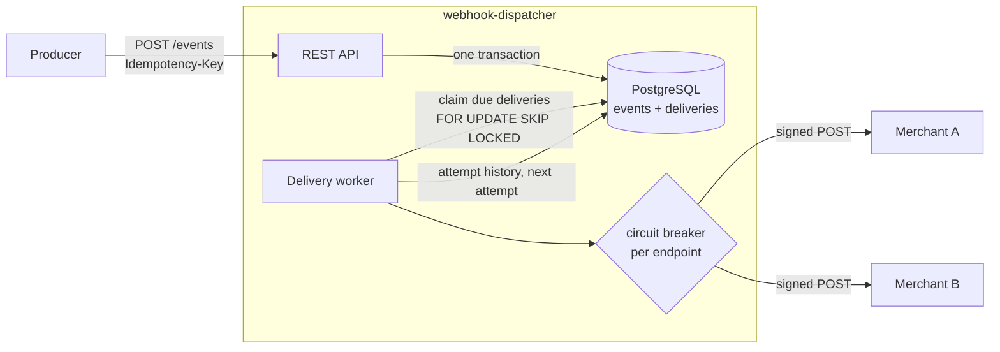

# webhook-dispatcher

Reliable **webhook delivery** in **Kotlin** with **Spring Boot 4**, **WebFlux and coroutines**, on
**Java 27**: the service a payments platform uses to tell its merchants "payment X succeeded",
with signed requests, retries with backoff, idempotent publishing and a circuit breaker per endpoint.

> Everything runs locally and for free: a JDK (Gradle downloads Java 27 if needed) and Docker for
> PostgreSQL. No API keys, no cloud services.

## The problem

When something happens on a payments platform (a payment succeeds, a refund is created, a payout is
sent), each merchant that subscribed to that event must be notified with an HTTP request to their
endpoint. It sounds simple, but production webhooks are a distributed-systems problem:

| Problem | How this service handles it |
|---|---|
| The producer retries a request after a timeout | **Idempotent publishing**: the same `Idempotency-Key` returns the original event, without delivering it twice |
| The service crashes right after accepting an event | **Transactional outbox**: the event and its deliveries are committed together in PostgreSQL before the `202` |
| The merchant's endpoint is down or slow | **Retries** with exponential backoff and jitter, `Retry-After` honoured, timeouts, and a **dead letter** after the last attempt |
| One endpoint fails for hours | **A circuit breaker per endpoint**: its deliveries wait instead of tying up workers, and other merchants aren't affected |
| Someone forges a webhook | Every request is **signed** (HMAC-SHA256, [Standard Webhooks](https://www.standardwebhooks.com) spec) |
| Several instances run at once | Deliveries are claimed with `FOR UPDATE SKIP LOCKED` and a **lease**: never sent by two workers, and picked up again if a worker dies |

## How it works



1. **Publish.** `POST /events` stores the event and one `PENDING` delivery per matching subscription
   in the same transaction (the outbox), then answers `202 Accepted`. Nothing is sent inside the
   request: a slow merchant never slows producers down.
2. **Claim.** Each instance runs a worker that claims due deliveries in batches with
   `FOR UPDATE SKIP LOCKED`, setting them `IN_FLIGHT` with a lease. Any number of instances can run
   it without sending a delivery twice; a delivery whose worker died is claimed again when its lease
   expires. A new event wakes the local worker up immediately; other instances find it on their next
   poll.
3. **Deliver.** Deliveries run concurrently (coroutines), at most `max-concurrency` at a time and at
   most `max-concurrency-per-subscription` per endpoint, so one slow merchant can't take every slot.
   Each request is signed and has bounded connect and response timeouts; redirects are not followed.
4. **Decide.** Every attempt goes into the delivery's history, and then:

| Response | Next |
|---|---|
| `2xx` | `DELIVERED` |
| Other `4xx` (and `3xx`) | `FAILED`: the endpoint refused it, retrying won't help |
| `408`, `429`, `5xx`, timeout, connection error | Retried after a backoff, or `DEAD` after the last attempt |
| Circuit open for this endpoint | Not attempted: postponed without using up an attempt |

Backoff is exponential (`initial-backoff × multiplier^(attempt−1)`, capped at `max-backoff`) with
**equal jitter**, so endpoints that failed together aren't all retried at the same instant; a longer
`Retry-After` from the endpoint wins. With the defaults the waits are at most 10s, 30s, 1.5min,
4.5min, 13.5min, 40min and 1h (each between half and all of that): 8 attempts over 1 to 2 hours. A `DEAD` or `FAILED` delivery can
be sent again with `POST /deliveries/{id}/retry`.

Delivery is **at least once**: a worker can die after the merchant received the request but before
recording it. That's why the `webhook-id` header is the same on every attempt: receivers use it to
discard duplicates.

## Webhook format

Following the [Standard Webhooks](https://www.standardwebhooks.com) spec, so receivers can verify
requests with its libraries:

```http
POST /webhooks HTTP/1.1
Content-Type: application/json
webhook-id: 0b9b5f3a-6a8c-4bb1-9f7e-0d5f8a3c2e11
webhook-timestamp: 1794477600
webhook-signature: v1,<base64 HMAC-SHA256>

{"type":"payment.succeeded","timestamp":"2026-11-12T10:00:00Z","data":{"paymentId":"pay_123","amount":4200}}
```

The signature is `base64(HMAC-SHA256(secret, "{webhook-id}.{webhook-timestamp}.{body}"))`, with the
subscription's `whsec_…` secret. A receiver recomputes it to check the request came from this service
and wasn't altered, and rejects old timestamps to prevent replays.

## API

Every call needs the `X-Api-Key` header. Errors are [RFC 9457](https://www.rfc-editor.org/rfc/rfc9457)
problem details (`application/problem+json`).

| Method | Path | Description |
|---|---|---|
| `POST` | `/subscriptions` | Registers an endpoint for some event types (`*` for all). Returns its signing secret, **only this once** |
| `GET` | `/subscriptions/{id}` | A subscription (without its secret) |
| `POST` | `/events` | Publishes an event. Requires `Idempotency-Key`. `202` when new; `200` with `Idempotent-Replayed: true` when repeated; `422` if the key was used for a different request |
| `GET` | `/events/{id}/deliveries` | The event's deliveries, with status and attempt history |
| `POST` | `/deliveries/{id}/retry` | Sends a `FAILED` or `DEAD` delivery again, with a new budget of attempts (`409` otherwise) |
| `GET` | `/actuator/health/liveness`, `/actuator/health/readiness` | Kubernetes probes (no API key) |
| `GET` | `/actuator/prometheus` | Metrics (no API key) |

```bash
docker compose up --build   # PostgreSQL and the dispatcher on :8080

# Subscribe an endpoint (any URL that accepts POSTs, e.g. a https://webhook.site URL)
curl -s localhost:8080/subscriptions -H "X-Api-Key: local-dev-key" -H "Content-Type: application/json" \
  -d '{"url":"https://webhook.site/<your-id>","eventTypes":["payment.succeeded"]}'

# Publish an event
curl -s localhost:8080/events -H "X-Api-Key: local-dev-key" -H "Content-Type: application/json" \
  -H "Idempotency-Key: $(uuidgen)" \
  -d '{"type":"payment.succeeded","data":{"paymentId":"pay_123","amount":4200}}'

# Follow its delivery
curl -s localhost:8080/events/<event-id>/deliveries -H "X-Api-Key: local-dev-key"
```

## Running locally

Requirements: a JDK to run Gradle (Gradle provisions Java 27 for the build if it isn't installed),
and Docker.

```bash
./gradlew build                     # compile, unit and integration tests (PostgreSQL in Testcontainers)

docker compose up -d postgres       # only the database...
DISPATCHER_API_KEY=local-dev-key DISPATCHER_ALLOW_INSECURE_URLS=true ./gradlew bootRun   # ...and the app

docker compose up --build           # or everything, from the Docker image
```

| Variable | Default | Description |
|---|---|---|
| `DISPATCHER_API_KEY` | (required) | Key clients send in `X-Api-Key` |
| `DB_HOST`, `DB_PORT`, `DB_NAME`, `DB_USER`, `DB_PASSWORD` | `localhost`, `5432`, `webhooks`, `webhooks`, `webhooks` | PostgreSQL |
| `DISPATCHER_ALLOW_INSECURE_URLS` | `false` | Accept `http` endpoints (local development) |
| `LOGGING_STRUCTURED_FORMAT_CONSOLE` | (unset) | `ecs` or `logstash` for JSON logs |

Retry, worker, timeout and circuit breaker settings are under `dispatcher.*` in
[`application.yaml`](src/main/resources/application.yaml), and can be overridden the same way (e.g.
`DISPATCHER_RETRY_MAX_ATTEMPTS=10`).

## Production readiness

- **Durability:** an accepted event is committed with its deliveries; delivery state and every
  attempt live in PostgreSQL, so restarts and deploys lose nothing.
- **Horizontal scaling:** stateless instances share the work through the claim query; leases recover
  deliveries from dead instances.
- **Graceful shutdown:** the worker stops claiming and lets the current batch finish (up to
  `shutdown-timeout`); the web server drains requests.
- **Observability:** `webhook.delivery.attempts` (timer by outcome), `webhook.delivery.postponed`,
  Resilience4j circuit breaker state and calls, HTTP server metrics, liveness and readiness probes,
  and optional structured JSON logs. Metric tags never include URLs, to keep cardinality bounded.
- **Security:** API key compared in constant time; `https`-only endpoints in production; no
  redirects followed; endpoint credentials in URLs rejected; secrets never logged or returned after
  creation; the container runs as a non-root user.
- **Schema migrations** with Flyway; a layered Docker image (dependencies cached separately from the
  code).

Known limits, and what a next step would be:

- Signing secrets are stored as-is in PostgreSQL; production would encrypt them (e.g. with a KMS key).
- Endpoint URLs aren't checked against private address ranges: a multi-tenant deployment needs SSRF
  protection (resolve the host and refuse internal IPs, or send through an egress proxy).
- Circuit breakers are per instance; with many instances each one learns an endpoint is down on its own.
- Event and attempt history is kept forever; production would add retention (partitioning by month).

## Design decisions

- **WebFlux with coroutines.** Delivering webhooks is almost all waiting: thousands of outgoing
  requests to endpoints that may take seconds. Non-blocking I/O handles that with a few threads, and
  coroutines keep the code sequential (`suspend` functions, structured concurrency for batches,
  `Semaphore` for limits) instead of `Mono`/`Flux` chains.
- **PostgreSQL as the queue (outbox) instead of a broker.** The event and its deliveries are written
  atomically with no dual write, and `SKIP LOCKED` makes PostgreSQL a solid work queue at this scale.
  A broker (Kafka, SQS) becomes worth it at a much higher volume; the outbox would then feed it.
- **R2DBC for the application, JDBC for Flyway.** Queries are non-blocking end to end; migrations run
  once at startup, where JDBC is simpler.
- **Explicit SQL (`DatabaseClient`) over a repository abstraction.** The claim query (`UPDATE … WHERE
  id IN (SELECT … FOR UPDATE SKIP LOCKED) RETURNING`, joined in a CTE) is the core of the system and
  is clearer written out.
- **Standard Webhooks signatures.** An open spec with libraries in many languages, instead of a
  homemade scheme each merchant has to implement.
- **Client errors aren't retried.** A `400` or `404` won't change by retrying; it's recorded as
  `FAILED` and can be retried by hand once the merchant fixes their endpoint.
- **Java 27 with Kotlin 2.4.** The application is built and runs on Java 27 (toolchain, CI and Docker
  image); Kotlin 2.4 emits bytecode up to Java 26, which runs as-is on 27.

## Testing

```bash
./gradlew build
```

The integration tests boot the whole application on a random port against PostgreSQL in
**Testcontainers**, and deliver to real HTTP endpoints (a small JDK `HttpServer` per test, scripted to
succeed, fail, time out or throttle):

- **`DeliveryIntegrationTest`:** delivery to matching subscriptions only, with the Standard Webhooks
  headers and a signature checked against the subscription's secret; retries with backoff until
  success; a `400` not retried; a dead letter after the last attempt, then delivered by a manual
  retry; `Retry-After` honoured; a timeout retried; an event nobody subscribed to.
- **`IdempotencyIntegrationTest`:** a repeated request returns the original event and delivers once; a
  key reused for a different request is a `422`; **10 concurrent requests** with the same key create
  a single event and a single delivery; the header is required.
- **`CircuitBreakerIntegrationTest`:** an endpoint that keeps failing trips its breaker and stops being
  called, its deliveries wait without using up attempts, and a healthy endpoint gets every event.
- **`ClaimIntegrationTest`:** concurrent claims never return the same delivery twice; a delivery whose
  worker died is claimed again once its lease expires.
- **`ApiIntegrationTest`:** API key required; probes and Prometheus metrics open, with delivery and
  circuit breaker metrics; URL and event type validation; the secret only shown at creation; `404`s
  and `409` as problem details.
- **Unit tests:** the signature against the Standard Webhooks reference example, and the retry policy
  (classification of every kind of response, backoff bounds with jitter, `Retry-After` parsing and caps).

CI runs the build and tests on Java 27 and builds the Docker image; Dependabot keeps Gradle
dependencies (including the wrapper), GitHub Actions and Docker images up to date.

## Tech stack

Kotlin 2.4 · Java 27 · Spring Boot 4.1 (WebFlux, coroutines) · R2DBC · PostgreSQL 18 · Flyway ·
Resilience4j · Micrometer / Prometheus · Testcontainers · JUnit 5 · AssertJ · Gradle 9 (Kotlin DSL,
version catalog) · Docker · GitHub Actions · Dependabot

## License

[MIT](LICENSE)
